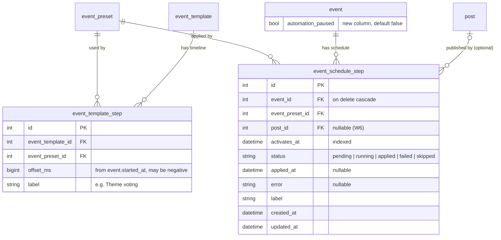

# Event automation: handoff & draft HLD

Context: [issue #386](https://github.com/alakajam-team/alakajam/issues/386). The goal is for an admin to schedule a jam once (they pick the main start time), and for the event to then move through its phases by itself, with the phase side-effects (theme shortlist, rankings) running at the right moment.

## 1. Where things stand

**What exists and now works.** The bugs were fixed in the PR that adds this document.

| Building block | What it does |
|---|---|
| **Preset** (`event_preset`, admin at `/admin/event-presets`) | A snapshot of the event statuses plus the home page countdown, with the deadline stored as an **offset in ms from `event.started_at`**. An empty status means "leave unchanged". |
| **Template** (`event_template`, admin at `/admin/event-templates`) | Defaults for a new event: title, links, divisions, rating categories, and **one** preset. |
| **Event settings → State tab** | The preset dropdown copies the preset into the form with client-side JS (`client/scripts/event/edit-event-status.ts`) and computes the countdown date from the start date. Any manual change clears the preset. |
| **Phase triggers** | Inline in `eventManage()` (`server/event/manage/settings/event-settings.controller.ts`): shortlist computation when the theme status is set to `shortlist`, rankings compute/clear when the results status changes, and tournament score recalculation when the tournament leaves `off`. |

**Test baseline:**
- Unit: `event-preset.service.spec.ts`, `event-template.service.spec.ts`, `admin-event-presets.controller.spec.ts`, `admin-event-templates.controller.spec.ts`.
- E2E: the preset scenarios in `e2e/tests/event-administration.spec.ts`, with the seeded preset `E2E_EVENT_PRESETS.jamStarted`.
- Fixtures: `createTestPreset` and `createTestTemplate`.

## 2. Handoff: remaining work

Listed in dependency order. The first two items are refactors that every automation design needs.

### W1. Apply a preset on the server
Today, only the browser can apply a preset. Add `eventPresetService.applyToEvent(event, preset)`:
- Copy the non-empty statuses.
- Set `countdown_config = { message, link, phrase, enabled, date: started_at + offset }`.
- Set `event_preset_id`.

Call it from `eventService.createEvent(template)`. The `it.fails("should apply the state of the template preset")` test in `event-template.service.spec.ts` is the acceptance test: switch it to `it` once this works. The client JS can stay as a preview.

### W2. Move the phase triggers out of the controller
Move `event-settings.controller.ts` lines "Run event triggers" through "Caches clearing" into a service, for example `eventStateService.saveEventState(event)`, which:
1. runs the triggers based on `hasChanged` / `previous`,
2. saves the event,
3. clears the caches (`eventsById`, `eventsByName`, the active tournament).

The settings form and the scheduler must both go through it. Add unit tests for each trigger, because today only E2E tests cover them.

### W3. Event schedule (data + service + tick)
Implement the HLD below (§3).

### W4. Admin UI
- **Template admin:** edit an ordered list of steps (preset + offset), and show the computed timeline for an example start date.
- **Event settings:** add a "Schedule" tab that lists the steps with their absolute dates, their status (pending / applied / failed / skipped), and each step's error. It needs add / remove / re-time actions, a **Pause automation** switch, and an **Apply now** button per step.
- **Preset admin:** list the events and templates that use each preset. The data is already loaded with `withRelated: ["events"]`.

### W5. Template coverage
Templates can't hold display dates, the displayed theme, the event flags (`streamerOnlyTournament`, `specialAwards`…), or the logo, banner and background. Add the fields that are worth templating. Also add a "Copy" action to the template list, as presets have.

### W6. Scheduled posts (optional)
Posts already support a future `published_at` (public queries filter on `published_at <= now`). The cheapest version is a `post_id` on a schedule step, which links the post and sets its `published_at` to the step date when the schedule is created. Social media posts are out of scope.

### W7. Notifications (optional)
When a step fails, or when automation pauses itself, notify the admins: a mod notification, plus email once #375 lands.

### Known limitations to address along the way
- `event.started_at` is edited with a **date-only** picker (`yyyy-MM-dd`, read as 00:00 UTC). Offsets therefore include the start hour (for example, "theme reveal" = +0d 18h). Either document this in the UI, or switch the picker to datetime. The column is already a datetime.
- Editing a preset doesn't change events already using it, because events store copied values. For scheduled steps, read the preset **when the step is applied**, not when the event is created (see the HLD).

## 3. Draft HLD

### 3.1 Goals / non-goals
- **Goals:**
  - A template defines a timeline of presets relative to the start.
  - Creating an event from a template creates its schedule.
  - Steps are applied automatically, exactly once, with the same side-effects as the manual form.
  - Admins can see, edit, pause and override the schedule.
- **Non-goals (v1):** a general cron framework, multi-process or multi-host scheduling, social media posting.

### 3.2 Approach: tick vs lazy evaluation
The thread in #386 proposed two options:

| | Lazy ("current state = latest step with `activates_at <= now`", resolved on read) | **Tick (recommended)** |
|---|---|---|
| Side-effects (shortlist, rankings) | Must run during a page request, with locking and latency on the request path | Run in the background, off the request path |
| Event columns | Every read needs a join and a resolution step, and every status read in the codebase must change | Unchanged. The event row stays the source of truth, so no read path changes |
| Manual overrides | Hard: the latest step always wins | Easy: an admin edit simply changes the row |
| Machinery | None | One `setInterval` in the main process |

The site runs as a single pm2 process (`deployment/upgrade.sh`), and the codebase already uses in-process timers and node-cache. A **60s in-process tick**, with a database-level claim on each step, is therefore enough and stays correct if a second process is ever added.

### 3.3 Schema



Migration `0049_event_schedule` (Knex, with the same SQLite foreign key caveats as `0026`):

```ts
await knex.schema.createTable("event_template_step", (table) => {
  table.increments("id").primary();
  table.integer("event_template_id").notNullable().references("event_template.id").onDelete("CASCADE");
  table.integer("event_preset_id").notNullable().references("event_preset.id");
  table.bigInteger("offset_ms").notNullable();
  table.string("label");
});

await knex.schema.createTable("event_schedule_step", (table) => {
  table.increments("id").primary();
  table.integer("event_id").notNullable().references("event.id").onDelete("CASCADE");
  table.integer("event_preset_id").notNullable().references("event_preset.id");
  table.integer("post_id").references("post.id");
  table.dateTime("activates_at").notNullable().index();
  table.string("status").notNullable().defaultTo("pending");
  table.dateTime("applied_at");
  table.string("error", 1000);
  table.string("label");
  table.timestamps();
  table.index(["status", "activates_at"]);
});

await knex.schema.table("event", (table) => {
  table.boolean("automation_paused").notNullable().defaultTo(false);
});
```

Design notes:
- `event_template.event_preset_id` stays as "initial state applied at creation" (W1). The timeline lives in the step table.
- The schedule stores **absolute** `activates_at` dates, computed from `started_at + offset_ms` when the schedule is created. If `started_at` changes later, the schedule service re-times the steps that are still pending, and the settings form asks for confirmation first.
- A step references the preset and doesn't copy it, so editing a preset changes the steps that haven't run yet. Deleting a preset that pending steps use must be refused, as `deleteEventPreset` already does for events.
- Add TypeORM entities under `server/entity/` (see `server/entity/README.md`), and Bookshelf models only if the Bookshelf-based services need them.

### 3.4 Components

```
server/event/schedule/
  event-schedule.service.ts     createFromTemplate(event, template), retime(event), findSteps(event),
                                runDueSteps(now), applyStep(step)
  event-schedule.scheduler.ts   start()/stop(): setInterval(TICK_MS) → runDueSteps(new Date())
server/event/manage/
  event-state.service.ts        saveEventState(event)          ← W2 (triggers + save + caches)
  settings/event-preset.service.ts  applyToEvent(event, preset) ← W1
```

`runDueSteps(now)`:
1. Select the steps where `status = 'pending' AND activates_at <= now` and the event's `automation_paused = false`, ordered by `event_id, activates_at`.
2. Claim each step atomically: `UPDATE event_schedule_step SET status='running', updated_at=now WHERE id=? AND status='pending'`. Continue only if exactly one row changed. Knex 0.21 returns the affected count on both SQLite and PostgreSQL.
3. Call `applyToEvent(event, preset)`, then `saveEventState(event)`, then publish the linked post if there is one. On success, set `status='applied'` and `applied_at`. On error, set `status='failed'` and `error`, set `automation_paused` on the event, and notify the admins (W7).
4. **Overdue steps** (server down, or automation paused then resumed) are applied **in order**, never skipped silently, because the side-effects build on each other: the shortlist must exist before the theme results. The admin can mark a step `skipped` by hand.

On startup, steps stuck in `running` (the process crashed mid-step) go back to `pending` if their event isn't paused, or to `failed` otherwise. The scheduler starts from `server/index.ts` after the database is initialized. It is disabled when `config.EVENT_AUTOMATION_ENABLED === false`, and in unit and E2E tests unless a test enables it.

### 3.5 Interaction with manual edits
- Manual changes in the settings form go through `saveEventState` like before. They don't touch the schedule.
- The "Apply now" button on a step calls `applyStep` and marks the step `applied`.
- Pausing doesn't stop manual edits. When an admin resumes, the UI lists the overdue steps that are about to run, so they can mark some as skipped first.

### 3.6 Testing strategy
- **Unit** (Vitest, test DB):
  - `createFromTemplate`, including negative offsets.
  - `retime`.
  - `runDueSteps` with an injected `now`: ordering, exactly-once under two concurrent calls, a failure that pauses the event, and paused events being skipped.
  - One test per trigger through `saveEventState`.
- **E2E:** add a dev/E2E-only route, `POST /admin/dev/run-schedule?now=…`, which is registered only by the E2E server (`server/scripts/e2e.ts`) and calls `runDueSteps` with a forged clock. A test creates an event from a template with a schedule, runs the schedule at T+0 and T+48h, and checks the event pages.

### 3.7 Rollout
1. W1 + W2: refactors only, with no behaviour change, covered by the existing E2E tests.
2. Migration, entities and the schedule service, with automation disabled by default.
3. Admin UI (W4).
4. Enable it in production for one jam, with the admins watching. The pause switch is the fallback.

### 3.8 Open questions
- Should `started_at` become a datetime in the UI (see "Known limitations" above)?
- Should a manual state change automatically pause automation, or should the next step still apply on schedule? The proposal above lets it apply, and makes the pause explicit.
- Are steps that publish a post (W6) needed for v1, or does scheduling posts by hand with a future publication date cover it?
